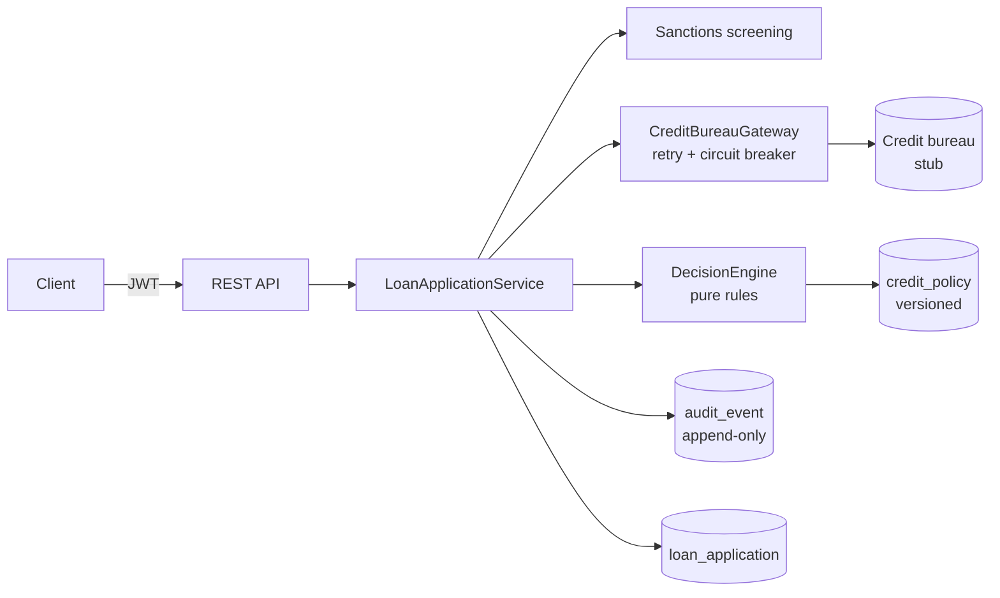

# Loan Decision Service

A Spring Boot microservice that takes a loan application, screens it, pulls a credit score, and returns an
explainable decision: **APPROVED**, **REJECTED** or **REFERRED** for a human underwriter.

I built it as a working answer to three problems every loan origination system (LOS) sold to banks and
credit unions has to solve:

1. **Every bank has different credit rules.** Rules live in the database, versioned per institution and
   product, and a risk admin changes them through the API. No code change or redeploy.
2. **External services fail.** The credit bureau call is wrapped in retry and a circuit breaker. If the
   bureau is down, the application is referred for manual review instead of erroring or being lost.
3. **Regulators ask "why?"** Every step is written to an append-only audit trail, and each decision
   records the exact policy version that produced it.

## Run it

Needs Docker only.

```bash
docker compose up -d --build
./scripts/demo.sh
```

Swagger UI: <http://localhost:8080/swagger-ui.html> · Health: <http://localhost:8080/actuator/health>

Demo output (trimmed):

```
== 1. Strong applicant (score 780)
APPROVED  score=780  emi=14192.19  foir=0.1577 ALL_RULES_PASSED
== 2. Weak applicant (score 640, low income, long tenure)
REJECTED  score=640  ... SCORE_BELOW_MIN: 640 < 700; INCOME_BELOW_MIN: 22000 < 25000; TENURE_ABOVE_MAX: 72 > 60; FOIR_ABOVE_MAX: 0.8105 > 0.5
== 3. Borderline score (715) goes to an underwriter
REFERRED  score=715  ... SCORE_IN_REVIEW_BAND: 715 < 730
== 4. Name on sanctions watchlist is never auto-decided
REFERRED  score=800  ... SANCTIONS_POSSIBLE_MATCH: compliance review required
== 6. Risk admin lowers PERSONAL min score to 680 (new policy version, no redeploy)
   PERSONAL policy now v2, minCreditScore=680
APPROVED  score=715  ... ALL_RULES_PASSED
== 8. Audit trail for that application
   APPLICATION_SUBMITTED    officer  product=PERSONAL amount=300000 tenure=24 pan=XXXXXXX15P
   SANCTIONS_SCREENED       system   possibleMatch=false
   BUREAU_SCORE_FETCHED     system   score=715
   DECISION_MADE            system   status=REFERRED policy=PERSONAL v1 (id 1) reasons=[SCORE_IN_REVIEW_BAND: 715 < 730]
   MANUAL_REVIEW_COMPLETED  risk     outcome=APPROVED note=Salary slips verified
== 9. Credit bureau outage: 3 attempts each, then referred instead of failing
REFERRED  score=None ... BUREAU_UNAVAILABLE: credit score could not be fetched
   circuit breaker: OPEN
```

## How it works



**Decision order** (`DecisionEngine`): any failing hard rule rejects and *every* failing rule is listed;
a possible sanctions match is always referred to compliance; a missing bureau score is referred, never
guessed; a score just above the minimum (the "refer band") goes to an underwriter; otherwise approve.
The engine has no I/O, so any decision can be replayed from stored inputs and its policy version.

**Rules checked:** minimum credit score, minimum monthly income, maximum loan amount, maximum tenure,
and FOIR (fixed obligations to income: existing EMIs plus the new EMI, divided by monthly income). EMI
uses the standard reducing-balance formula with `BigDecimal`.

## API

| Method | Path | Role | Purpose |
| --- | --- | --- | --- |
| POST | `/api/v1/auth/token` | public | Demo login, returns a JWT scoped to one institution |
| POST | `/api/v1/applications` | OFFICER | Submit and decide. Optional `Idempotency-Key` header |
| GET | `/api/v1/applications/{id}` | OFFICER | Fetch an application (own institution only) |
| GET | `/api/v1/applications/{id}/audit` | OFFICER | Full audit trail |
| POST | `/api/v1/applications/{id}/review` | RISK_ADMIN | Approve or reject a referred application |
| GET | `/api/v1/policies` | OFFICER | Active rules for the caller's institution |
| PUT | `/api/v1/policies/{product}` | RISK_ADMIN | Publish a new policy version |
| GET | `/api/v1/policies/{product}/history` | OFFICER | All versions, newest first |

Demo users: `officer / officer123` and `risk / risk123` (DEMO_BANK), `coop-officer / coop123` (COOP_BANK).

The stub bureau is deterministic: the four digits of the PAN choose the score (`ABCDE0420F` → 720, i.e.
300 + digits up to 0600), and `9999` simulates an outage.

## Design choices

- **Institution comes from the token, not the request body.** An officer at one bank cannot submit
  for, read, or see the audit trail of another bank's applications. Cross-tenant reads return 404.
- **Idempotent submission.** Mobile and branch clients retry on flaky networks; the same
  `Idempotency-Key` returns the original decision (`200` + `Idempotent-Replay: true`) instead of
  creating a duplicate loan. A unique constraint covers the concurrent-retry race.
- **No raw PAN at rest.** Only a masked PAN (`XXXXXXX15P`) and a SHA-256 hash are stored.
- **External calls outside DB transactions,** so a slow bureau never holds a connection.
- **Policy rows are immutable.** Publishing deactivates the current version and inserts the next one in
  a single transaction; old decisions keep pointing at the version they were made under.
- **Errors are RFC 9457 problem responses** (`400` validation, `401`, `403`, `404`, `409`, `422` no policy).

## Tests and CI

`mvn verify` runs 19 tests: decision-engine and EMI unit tests, a Mockito service test, and full-stack
MockMvc tests against a Flyway-migrated H2 database (JWT auth, role checks, tenant isolation,
idempotency, sanctions, bureau outage, policy versioning).

GitHub Actions (`.github/workflows/ci.yml`) runs the tests, builds the Docker image, then starts the
Compose stack on Postgres and runs `scripts/demo.sh` as a smoke test.

Running tests without a local JDK:

```bash
docker run --rm -v "$PWD":/src -v los-m2:/root/.m2 -w /src maven:3.9-eclipse-temurin-21 mvn -B verify
```

## Stack

Java 21 · Spring Boot 3.4 · Spring Data JPA / Hibernate · PostgreSQL 16 · Flyway · Spring Security
(OAuth2 resource server, HS256 JWT) · Resilience4j · springdoc-openapi · JUnit 5 · Mockito · Maven ·
Docker (multi-stage, non-root) · Docker Compose · GitHub Actions

## What I would add next

- Real bureau and eSign adapters behind the existing ports, with contract tests.
- An outbox table and Kafka events (`ApplicationDecided`) so disbursement and notification services react
  asynchronously.
- Keyed HMAC for the PAN hash, secrets from a vault, and the bank's identity provider instead of demo users.
- Fuzzy name matching (Jaro-Winkler) for sanctions screening, and a maker-checker step on policy changes.
- Testcontainers so integration tests run on Postgres instead of H2.

---

Independent prototype by [Chinthan Shetty](https://chinthanshetty.in). Not affiliated with any bank or vendor;
all data is synthetic.
